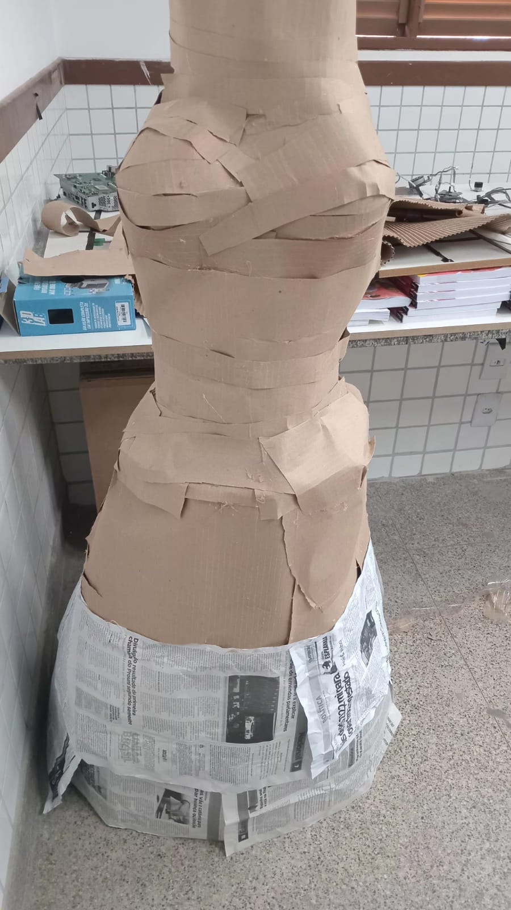
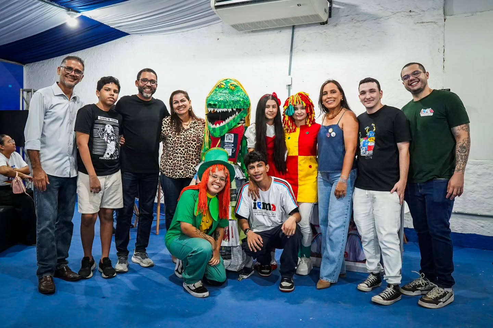

# 🤖 Cuca Bot — Dual ESP32 Interactive System

Projeto robótico interativo baseado em uma arquitetura **Mestre–Escravo com dois ESP32**, comunicação UART, detecção de cores, movimentação da base e reprodução de áudio por **Bluetooth A2DP**.

A Cuca Bot também participou da **Olimpíada Brasileira de Robótica (OBR)** com uma base quadrada de madeira, **8 motores DC** (quatro de cada lado) e **2 pontes H L298N**. A versão integrada documentada abaixo reúne essa lógica de locomoção, o motor de passo **28BYJ-48** e a comunicação com o ESP32 de áudio. **Os firmwares da OBR e da versão integrada são diferentes**; a nova pinagem não deve ser aplicada a códigos antigos sem conferir as conexões.

---

## 📌 Arquitetura do Sistema

### 🧠 ESP32 Mestre — Sensores e movimentos

No código integrado, o mestre é responsável por:

- Ler o sensor óptico **TCS230/TCS3200** e confirmar duas vezes a detecção da cor verde.
- Acionar os **8 motores DC**, agrupados pelos quatro canais de duas pontes H L298N.
- Acionar o motor de passo **28BYJ-48**, por meio do driver **ULN2003**.
- Enviar `TOCAR:1` até `TOCAR:14` ao ESP32 Escravo via **UART2, 115200 baud**.
- Receber `FIM` do escravo e aguardar a retirada do objeto verde antes de avançar para a próxima fala.

> **OTA no Mestre:** o firmware integrado apresentado nesta versão não contém `WiFi` nem `ArduinoOTA`. Outras versões do projeto possuem suporte a atualização remota.

### 🔊 ESP32 Escravo — Áudio

O escravo concentra a reprodução das falas para não carregar o firmware do mestre com os grandes arrays de áudio:

- Recebe os comandos `TOCAR:X` pela `Serial2` (UART, **115200 baud**).
- Utiliza áudio WAV previamente convertido para um array C++ (`audios_unificados`, no arquivo `audio.h`), armazenado em Flash (`PROGMEM`).
- Seleciona um trecho pela minutagem definida em `listaTrechos` (14 falas).
- Lê amostras de áudio de **8 bits / 8 kHz** e as converte para a saída estéreo de **16 bits / 44,1 kHz** usada na transmissão **Bluetooth A2DP**.
- Envia `FIM` ao mestre após concluir o trecho (ou imediatamente se a caixa Bluetooth estiver desconectada quando receber o comando).
- Possui **Wi-Fi e ArduinoOTA** no código apresentado para o escravo.

A reprodução A2DP exige um **ESP32 com Bluetooth Classic**; o ESP32-S3 não suporta esse perfil da mesma forma que o ESP32 clássico.

### 🔄 Fluxo de interação da versão integrada

```text
Objeto verde detectado
         |
         v
ESP32 Mestre confirma duas leituras
         |
         +---- UART: "TOCAR:X" ----> ESP32 Escravo
         |                             |
         v                             v
Movimentos da base (8 DC)      Áudio via Bluetooth A2DP
         |                             |
         v                             |
Motor de passo (+100 / -100)          |
         |                             |
         +<------- UART: "FIM" --------+
         |
         v
Aguarda retirar o objeto verde
         |
         v
Próxima fala, até completar 14
```

O mestre **envia o comando antes de iniciar os movimentos**, mantém os movimentos com as durações programadas e depois espera `FIM`. O código possui **timeout de 20 segundos na etapa de espera**, contados **após** os movimentos; caso expire, ele prossegue sem confirmação de áudio. O motor de passo executa **um vai e vem por ação**, não durante toda a reprodução. Na ação 13, os motores DC ficam parados, mas o motor de passo ainda executa esse vai e vem no firmware atual.

### 🚗 Base de locomoção — Versão OBR

A base original era **quadrada, de madeira e pesava aproximadamente 3 kg**, com **oito motores TT amarelos**, distribuídos em quatro motores por lado, e **duas pontes H L298N**. Cada L298N possui dois canais; o código controla quatro grupos: traseira esquerda, dianteira esquerda, traseira direita e dianteira direita.

| Componente | Quantidade | Função |
|---|---:|---|
| Motores DC TT amarelos | 8 | Locomoção da base |
| Módulos L298N | 2 | Controle dos quatro grupos de motores |
| ESP32 de controle | 1 | Detecção de cor e acionamento dos motores |
| Sensor TCS230/TCS3200 | 1 | Gatilho das sequências de movimento |
| Bateria utilizada na base histórica | 1 (12 V) | Alimentação do sistema, conforme a montagem original |

> **Atenção:** a alimentação da base histórica era feita com uma bateria de 12 V, mas muitos motores TT amarelos são especificados para **3–6 V**. Não se deve aplicar 12 V diretamente a esses motores sem verificar a tensão nominal de seu modelo e utilizar redução de tensão apropriada. Houve desgaste e danos mecânicos nos motores da montagem original; esta informação não comprova, por si só, a causa das falhas.

---

## 🔌 Pinagem e Conexões

### 1. ESP32 Mestre — Versão integrada atual

As tabelas abaixo seguem o **último código do mestre compartilhado**, com UART em 16/17 e motor de passo transferido para 5/15/22/23. Todos os GPIOs citados nesta seção pertencem ao **mestre**.

**Sensor de cor — TCS230/TCS3200**

| Pino do sensor | GPIO do ESP32 Mestre |
|---|---|
| S0 | 25 |
| S1 | 26 |
| S2 | 18 |
| S3 | 19 |
| OUT | 35 (somente entrada) |

**Ponte H 1 — Lado esquerdo (L298N)**

| Entrada L298N | Constante no código | GPIO do Mestre | Grupo |
|---|---|---:|---|
| IN1 | `IN1` | 13 | Traseira esquerda |
| IN2 | `IN2` | 12 | Traseira esquerda |
| IN3 | `IN3` | 14 | Dianteira esquerda |
| IN4 | `IN4` | 27 | Dianteira esquerda |

**Ponte H 2 — Lado direito (L298N)**

| Entrada L298N | Constante no código | GPIO do Mestre | Grupo |
|---|---|---:|---|
| IN1 | `IN5` | 33 | Traseira direita |
| IN2 | `IN6` | 32 | Traseira direita |
| IN3 | `IN7` | 21 | Dianteira direita |
| IN4 | `IN8` | 4 | Dianteira direita |

O programa aciona **quatro canais de ponte H**. Como são oito motores físicos, a distribuição de **dois motores por canal** precisa ser confirmada na fiação real; o código, sozinho, não especifica como cada par de motores está conectado. Os pinos **ENA/ENB** das L298N também não são controlados por este firmware, de modo que a configuração dos jumpers/habilitação deve ser verificada na montagem.

**Motor de passo — ULN2003 + 28BYJ-48**

| Entrada ULN2003 | GPIO do ESP32 Mestre |
|---|---:|
| IN1 | 5 |
| IN2 | 15 |
| IN3 | 22 |
| IN4 | 23 |

Configuração no código:

```cpp
const int passosPorVolta = 2048;
const int passosMovimento = 100;
meuMotorPasso.setSpeed(17);
```

Após cada ação, o motor gira **100 passos em um sentido e 100 passos no sentido oposto**; depois suas bobinas são desligadas.

> **Cuidados de boot:** os GPIOs **5, 12 e 15** são pinos de *strapping* em modelos clássicos de ESP32. Módulos externos que alterem seus níveis durante a inicialização podem impedir o boot. Teste com ULN2003 e L298N conectados, antes de habilitar a alimentação dos motores.

### 2. UART — Conexão entre os dois ESP32

A versão integrada usa **UART2 (`HardwareSerial(2)` / `Serial2`) em ambos os ESP32**, com **115200 baud, 8N1**.

| ESP32 Mestre | Ligação | ESP32 Escravo |
|---|:---:|---|
| GPIO 17 — **TX2** | → | GPIO 16 — **RX2** |
| GPIO 16 — **RX2** | ← | GPIO 17 — **TX2** |
| GND | ↔ | GND |

```cpp
// ESP32 Mestre
HardwareSerial SerialAudio(2);
SerialAudio.begin(115200, SERIAL_8N1, 16, 17);

// ESP32 Escravo
Serial2.begin(115200, SERIAL_8N1, 16, 17);
```

**TX liga em RX; RX liga em TX.** Os dois módulos devem compartilhar **GND**. A pinagem presume placas ESP32 clássicas nas quais os GPIOs 16/17 estejam disponíveis (algumas placas com PSRAM podem reservá-los).

**Protocolo serial:**

| Mensagem | Origem | Destino | Finalidade |
|---|---|---|---|
| `TOCAR:1` … `TOCAR:14` | Mestre | Escravo | Iniciar a fala indicada |
| `FIM` | Escravo | Mestre | Informar o encerramento da fala |

### 3. Sequência dos motores DC

| Função | Comportamento |
|---|---|
| `moverFrente()` | Aciona os grupos para avançar |
| `moverTras()` | Aciona os grupos no sentido de recuo |
| `girarEsquerda()` | Comanda lados em sentidos opostos para virar à esquerda |
| `girarDireita()` | Comanda lados em sentidos opostos para virar à direita |
| `pararMotores()` | Coloca todas as entradas das pontes H em LOW |

O sensor realiza **duas verificações do verde**, separadas por **60 ms**. O código usa `pulseIn(..., LOW, 20000)` e considera verde válido quando `g > 15`, `g < r`, `g < b` e `g < 200`. Após executar cada ação, aguarda a retirada do objeto verde (também com dupla confirmação) para evitar repetições involuntárias.

**Movimentações específicas nas 14 ações:**

| Ação | Movimento programado para a base DC |
|---|---|
| 3 | Alterna frente/trás, 200 ms por comando, por cerca de 3 s |
| 4 | Avança por 3 s e alterna giros de 150 ms por cerca de 3 s |
| 6 | Alterna giros de 600 ms por cerca de 4 s |
| 7 | Alterna giros de 250 ms por cerca de 4 s |
| 13 | Base parada |
| Demais ações | Frente 150 ms, trás 150 ms, e para |

As ações de movimento são **bloqueantes** (uso de `delay()`), e a sequência encerra após a 14ª fala.

### 4. Versões anteriores e adaptações

**Versão da OBR (firmware autônomo original):** já utilizava as mesmas entradas das duas pontes H e a mesma pinagem TCS3200 da base mostradas acima, mas não incluía, naquele código, comunicação UART, reprodução de áudio por ESP32 Escravo ou OTA. A versão integrada adicionou esses subsistemas posteriormente.

**Versões antigas com ULN2003:** o README anterior registrava o motor de passo nos GPIOs **13, 4, 12 e 5**, com o sensor TCS3200 em **25, 26, 27, 14 e 35**. Essa pinagem é histórica e **conflita com as pontes H da base**; não deve ser usada com o firmware integrado atual.

**Adaptações com HC-SR04 (`adaptacoes/`):** alguns firmwares de apresentações utilizam o sensor ultrassônico em vez do sensor de cor. O README antigo registrava `Trig → GPIO 5` e `Echo → GPIO 18`. Esses mapeamentos são específicos das versões antigas e **não devem ser combinados automaticamente** com a versão integrada, em que o GPIO 5 é usado pelo motor de passo. Verifique sempre o código da adaptação antes da montagem.

---

## 🛠️ Requisitos de Hardware e Alimentação

### 1. ESP32, UART e áudio

- Alimente cada ESP32 com tensão adequada à respectiva placa e use **GND comum** para a comunicação UART.
- No código do escravo, a reprodução exige uma caixa Bluetooth compatível com **A2DP Sink**. O nome do dispositivo é definido em `nomeCaixinhaBT`.
- A versão do escravo possui Wi-Fi e `ArduinoOTA`. Configure as credenciais de forma segura; **não publique senhas reais no repositório**.
- Um capacitor de desacoplamento/reserva de **470 µF a 1000 µF** próximo à alimentação do escravo pode ajudar em picos de corrente, sem substituir uma fonte devidamente dimensionada.
- O motor 28BYJ-48 deve receber alimentação apropriada **pelo ULN2003**, não pelos GPIOs do ESP32.

### 2. Motores DC e bateria

A base histórica utilizou **uma bateria de 12 V** e **duas pontes H L298N**. Para remontagem ou atualização:

- Verifique a **tensão nominal dos motores** antes de ligar a bateria; motores TT amarelos comuns não devem receber 12 V diretamente quando sua especificação é 3–6 V.
- Se usar bateria de 12 V com motores de menor tensão, empregue conversão DC-DC dimensionada para a corrente dos motores.
- Cada canal da L298N deve suportar a **soma das correntes** dos motores conectados, inclusive na partida e em travamento; respeite também os limites térmicos do módulo.
- A L298N apresenta queda de tensão e dissipação de calor: considere isso ao dimensionar a alimentação.
- Não conecte motores diretamente aos GPIOs do ESP32.
- Para suportar peso e impactos, evite transferir todo o esforço lateral das rodas aos eixos dos motores; considere mancais/rolamentos e fixação reforçada.
- Teste primeiro com a base suspensa, verificando sentido de giro, corrente e aquecimento antes de colocá-la no chão.

### 3. Dispositivo de áudio

O firmware do escravo transmite áudio por **Bluetooth A2DP** para uma caixa compatível. Os áudios ficam incorporados ao firmware em arrays C++, sem necessidade de cartão SD nessa implementação.

---

## 💻 Bibliotecas Utilizadas

| Biblioteca / recurso | Aplicação |
|---|---|
| [`ESP32-A2DP`](https://github.com/pschatzmann/ESP32-A2DP) | Transmissão de áudio do escravo por Bluetooth |
| `Stepper` | Controle do 28BYJ-48 pelo mestre |
| `HardwareSerial` / `Serial2` | UART entre mestre e escravo |
| `ArduinoOTA` | Atualização remota no firmware do escravo e em algumas versões históricas |
| `WiFi` | Conexão de rede para OTA onde implementada |
| `Arduino.h` | GPIOs, sensor de cor e lógica das pontes H |
| `audio.h` | Array C++ contendo as amostras de áudio |

---

## 📖 Nossa Trajetória com a Cuca

O projeto **Cuca Bot** nasceu da união entre eletrônica, programação, robótica e cultura popular.

Ao longo do tempo, o robô passou por diversas etapas de desenvolvimento, testes, melhorias e conquistas que marcaram nossa trajetória.

### 🛠️ 1. Processo de Desenvolvimento e Montagem

Tudo começou na bancada de testes, com a soldagem dos componentes, ajustes eletrônicos, organização das conexões e construção da estrutura física do robô.

A integração dos dois microcontroladores ESP32 foi uma etapa fundamental para o funcionamento do sistema de áudio e controle.

A base motorizada, composta por **8 motores DC e 2 pontes H**, também representou uma etapa importante no desenvolvimento, permitindo que a Cuca realizasse movimentos durante as interações com o público.

<p align="center">
  
  
</p>

### 🥉 2. Conquista na Olimpíada Brasileira de Robótica (OBR)

Levamos a Cuca para competir na **Olimpíada Brasileira de Robótica (OBR)** e conquistamos o **3º lugar**!

Durante a competição, a Cuca utilizou sua base com **8 motores DC e 2 pontes H**, executando movimentos programados a partir da detecção de cores.

Essa conquista representou o reconhecimento do nosso esforço, dedicação e trabalho em equipe durante o desenvolvimento do projeto.

.jpeg)

.jpeg)

### 🎪 3. Destaque e Abertura na Expoema — Estande do IEMA

Graças ao sucesso do projeto, fomos convidados para participar da **abertura da Expoema, no estande do IEMA**.

Durante o evento, a Cuca teve a oportunidade de interagir com o público, demonstrando a aplicação prática da robótica e representando nosso trabalho.



---

## 👥 Autores

Projeto desenvolvido por:

- **Ana Beatriz** — [@anabeatriz26920](https://github.com/anabeatriz26920)
- **Mosaniel** — [@mosanielbr-hub](https://github.com/mosanielbr-hub)

---

## 📄 Licença

Este projeto é proprietário e confidencial. Desenvolvido por **Ana Beatriz** e **Mosaniel**. Todos os direitos reservados. É proibida a utilização, cópia ou distribuição sem autorização expressa.
